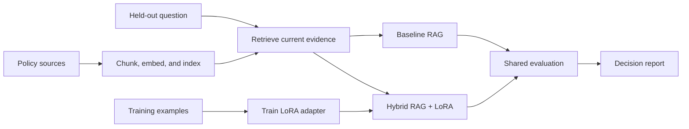
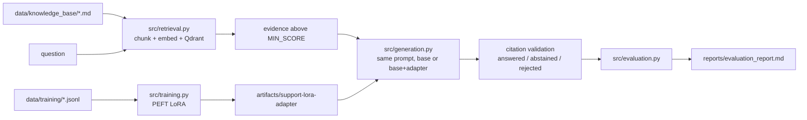

# Fine-Tuning + RAG Project

Use this repository as a **template** for your hybrid language-model
project. Build an assistant for the fictional Northstar customer-support team
that retrieves current policy evidence and uses a locally trained LoRA adapter to produce concise,
evidence-aware replies. Create pull requests in your own copy even if you are
working alone, and use them to track your progress.

This assignment combines the earlier work on
retrieval-augmented generation (RAG),
vector search, and parameter-efficient fine-tuning.
It follows the earlier strategy lesson by turning the selected hybrid pattern
into an assessed implementation with a real local fine-tuning run and a
measured comparison against a baseline RAG system.

## Learning Objectives

By the end of this repository, you should be able to:

- Build a hybrid RAG + LoRA system with a real, locally trained adapter.
- Benchmark the hybrid system against a baseline RAG pipeline on the same
  held-out cases.
- Separate retrieval quality from answer relevance, faithfulness, response
  style, and abstention behavior.
- Decide whether adaptation adds enough value to justify its training,
  deployment, and maintenance cost.

## Learning Path



| File / Folder | Description |
|---|---|
| [**Project Description**](project-description.md) | Scenario, milestones, deliverables, and acceptance checklist. |

### Additional Folders and Files

| File / Folder | Description |
|---|---|
| [**data/knowledge_base**](data/knowledge_base/) | Approved support policies the assistant may cite. |
| [**data/training**](data/training/) | Example support replies for training the LoRA adapter. |
| [**data/evaluation**](data/evaluation/) | Labeled questions for benchmarking both systems. |
| [**solution**](solution/README.md) | Runnable reference implementation and tests. Inspect after attempting the project. |
| [**.env.example**](.env.example) | Local model and retrieval configuration template. |
| [**pyproject.toml**](pyproject.toml) | Project configuration and dependencies. |
| [**uv.lock**](uv.lock) | Dependency lock file. |

## Setup

Use [uv](https://docs.astral.sh/uv/getting-started/installation/) 0.13.5 or newer
and Python 3.13.17 or a newer 3.13 patch release, as defined in
[`.python-version`](.python-version).

> [!NOTE]
> Throughout these steps, text in angle brackets like `<repo-name>` is a **placeholder**. Replace it, including the `< >` brackets, with your own value. For example, `cd <repo-name>` becomes `cd mle-finetuning-rag-project`.

### 1. Create the Repository from the Template

Click **Use this template** on GitHub.

When creating the repository:

- Set yourself as the **Owner**
- Choose a repository name
- Disable **Include all branches**
- Click **Create repository**

> [!IMPORTANT]
> If you are working in pairs or groups, only **one person** should complete this step.

---

### 2. Add Collaborators (Pairs/Groups Only)

If working with teammates:

1. Open the repository on GitHub
2. Go to **Settings → Collaborators**
3. Add your teammates as collaborators
4. Share the repository link with your team

Teammates should accept the invitation before continuing.

---

### 3. Clone the Repository

Copy the SSH URL from the **Code** button on GitHub, then run:

```bash
git clone <copied-ssh-url>
```

The copied SSH URL will look like `git@github.com:<your-username>/<repo-name>.git`.

---

### 4. Move into the Project Folder and Install Dependencies

The command below installs all dependencies and creates a virtual environment in `.venv/`.

```bash
cd <repo-name>
uv sync
```

The first training and evaluation runs download the configured public models from the [Hugging Face Hub](https://huggingface.co/docs/hub/index). The reference solution uses local Sentence Transformers embeddings, Qdrant local mode, and SmolLM2 with PEFT. The default base and embedding model revisions are pinned. Set `BASE_MODEL_REVISION` or `EMBEDDING_REVISION` explicitly when changing models. No hosted service or API key is required. Keep generated adapters, vector storage, and evaluation traces out of Git.

---

### 5. Set Up Environment Variables

Copy the default local model and retrieval settings:

```bash
cp .env.example .env
```

The reference solution runs locally without a hosted API key. Keep the default settings for your first run; `.env` lets you change them later.

> [!CAUTION]
> Never commit `.env`. It is git-ignored because environment files often hold secrets. Only `.env.example`, with placeholder or default values, belongs in the repository.

---

### 6. Open the Repository in VS Code

> [!NOTE]
> Make sure you open VS Code from the project root so it automatically detects the environment created by `uv sync`.

Launch VS Code in the project root folder:

```bash
code .
```

Select the Python interpreter in `.venv/` created by `uv sync`. Run the [reference solution commands](solution/README.md#run-the-reference-workflow) from the project root.

## Required Deliverables

Your repository must include:

- reproducible policy ingestion, chunking, embedding, indexing, and retrieval,
- a real local LoRA training command and saved adapter configuration,
- baseline RAG and hybrid RAG + LoRA answer paths using the same retriever,
- citation validation and abstention when evidence is unsupported,
- evaluation code that reports retrieval quality separately from answer
  relevance, faithfulness, style compliance, and decision accuracy,
- `reports/evaluation_report.md` with a per-case comparison, failure analysis,
  threshold decision, and prioritized next experiments,
- tests covering data contracts, retrieval metadata, unsupported questions,
  citations, and report generation,
- a concise README explaining architecture, commands, and conclusions.

## Implementation Summary

### Architecture



| Module | Role |
|---|---|
| [src/data_validation.py](src/data_validation.py) | Data contracts: IDs, source references, train/eval separation. |
| [src/retrieval.py](src/retrieval.py) | Paragraph chunking with metadata, MiniLM embeddings, local Qdrant, top-k and score threshold. |
| [src/training.py](src/training.py) | LoRA training with PEFT (r=8, alpha=16, dropout=0.05, `q_proj`/`v_proj`); loss on answer tokens only. |
| [src/generation.py](src/generation.py) | Prompt, greedy generation, citation validation, abstention. |
| [src/evaluation.py](src/evaluation.py) | Metrics for both paths on the same evidence and the Markdown report. |
| [src/answer.py](src/answer.py) | Answer one question; `--mode hybrid` reloads the saved adapter. |
| [tests/](tests/) | Fast tests (fake encoder, no downloads). CI: [.github/workflows/ci.yml](.github/workflows/ci.yml). |

### Commands

```bash
uv sync
uv run python -m src.data_validation          # validate data contracts
uv run python -m src.retrieval                # retrieval smoke test
uv run python -m src.training                 # train and save the adapter (~5 min on a laptop CPU)
uv run python -m src.answer "What is the usual standard shipping time?" --mode hybrid
uv run python -m src.evaluation               # writes reports/evaluation_report.md
uv run pytest tests                           # run from the repo root; always pass `tests`
```

Models are loaded in float32. The SmolLM2 checkpoint defaults to bfloat16, which was
about 150x slower per step on the CPU used here.

### Results (14 held-out cases, CPU)

| Metric | Baseline RAG | Hybrid RAG + LoRA |
|---|---|---|
| recall@3 / MRR | 1.00 / 1.00 | 1.00 / 1.00 |
| required-term coverage | 0.30 | 0.20 |
| citation faithfulness (of answered) | 0.71 | 0.83 |
| style compliance | 0.93 | 0.93 |
| decision accuracy | 0.86 | 0.86 |
| rejected (uncited or invalid) | 0.36 | 0.43 |

Full per-case evidence, failure analysis and the threshold study are in
[reports/evaluation_report.md](reports/evaluation_report.md). The numbers come from one
run with seed 42 on 14 cases, so one case moves a metric by about 7 points.

### Answers to the project questions

1. **Which held-out behaviors changed after loading the adapter?** Only a few cases: `eval-passport` went from answered to rejected, `eval-duplicate-payment` lost required-term coverage, and the wording changed on several others. Decisions on supported versus unsupported questions did not change.
2. **Did the adapter improve evidence use, style, both, or neither?** Neither convincingly. Citation faithfulness rose from 0.71 to 0.83 but that is computed over fewer answered cases; term coverage fell and style compliance is unchanged.
3. **Which retrieval errors limit both systems?** Two unsupported questions (`eval-bank-chargeback`, `eval-shipping-compensation`) retrieve a related policy above the threshold and are answered instead of abstained. Supported and unsupported top-1 scores overlap (supported 0.547–0.900, unsupported up to 0.631), so no `MIN_SCORE` separates them. Retrieval of supported cases is perfect (recall and MRR 1.00).
4. **Does the improvement justify adapter training and maintenance?** Not on this evidence. The gains are within noise and offset by regressions. Keep the baseline as the default.
5. **What experiment would reduce uncertainty most?** Retrain on more varied examples (including many abstentions and cited answers) with a validation split, then compare on a larger held-out set with several seeds. Also add a reranker or a stricter threshold check for the two failing unsupported cases.

### Limitations

- Citation validity shows a citation was retrieved, not that the claim is supported.
- The style metric is a proxy (at most 3 sentences and 80 words).
- Some evaluation topics overlap with training topics, which can overstate the adapter's benefit.
- A common failure is a correct but uncited answer (for example the shipping-time answer), which the validator rejects by design.

## References & Further Reading

- [Hugging Face Causal Language Modeling](https://huggingface.co/docs/transformers/tasks/language_modeling)
- [Sentence Transformers Semantic Search](https://www.sbert.net/examples/sentence_transformer/applications/semantic-search/README.html)
- [Hugging Face PEFT LoRA guide](https://huggingface.co/docs/peft/developer_guides/lora)
- [Qdrant Local Quickstart](https://qdrant.tech/documentation/quickstart/)
- [Ragas Metrics](https://docs.ragas.io/en/stable/concepts/metrics/available_metrics/)
